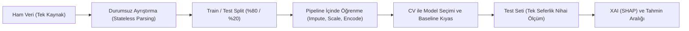

# Makine Öğrenmesi Projeleri İçin Uygulamalı Kılavuz: Kurallar, Veri İnceleme ve Temizleme Yöntemleri

Bu kılavuz, `used_cars.csv` (İkinci El Araç Fiyat Tahmini) projesi geliştirilirken karşılaşılan gerçek veri problemleri, metodolojik tuzaklar ve mühendislik çözümlerinden yola çıkılarak hazırlanmıştır. Tablosal (tabular) verilerle yapılan her makine öğrenmesi projesinde başvurulabilecek uçtan uca bir referans dokümanıdır.

---

## 1. Makine Öğrenmesi Projelerinde 8 Altın Kural



### Kural 1: Önce Böl (Split), Sonra Öğren — Veri Sızıntısını (Data Leakage) Önle
Veri kümesinden herhangi bir istatistik öğrenen her işlem (ortalama/medyan ile eksik doldurma, standartlaştırma, hedef kodlama, özellik seçimi, IQR ile aykırı değer silme) **yalnızca eğitim (train) seti üzerinde** hesaplanmalıdır (`fit`).
- **Yanlış:** Tüm veri üzerinde `StandardScaler().fit_transform(df)` veya `df.fillna(df.median())` yapıp ardından `train_test_split` uygulamak.
- **Doğru:** İlk adımda `train_test_split` yapmak; öğrenen tüm adımları `sklearn.pipeline.Pipeline` ve `ColumnTransformer` içine koyarak her çapraz doğrulama katmanının (fold) yalnızca kendi eğitim alt kümesinden öğrenmesini sağlamak.

### Kural 2: Durumsuz (Stateless) Ayrıştırma ile Öğrenen (Stateful) Dönüşümleri Ayır
Tek bir satıra bakarak yapılabilen deterministik işlemler **durumsuzdur**; diğer satırların dağılımına ihtiyaç duyan işlemler **durumludur (stateful)**:

| Dönüşüm Türü | Örnek İşlemler (`used_cars.csv`) | Nerede Yapılır? |
|---|---|---|
| **Durumsuz (Stateless)** | `"$10,300" -> 10300.0`, `"51,000 mi." -> 51000.0`, `"300.0HP 3.7L V6" -> (300, 3.7, 6)`, `age = reference_year - model_year` | `features.py` (Saf fonksiyonlar, birim testlerle doğrulanır) |
| **Öğrenen (Stateful)** | Eksik `horsepower` için medyan hesabı, `StandardScaler` ortalama/varyansı, `OneHotEncoder` nadir kategori eşiği, `TargetEncoder` marka/model ortalamaları | `pipeline.py` (`ColumnTransformer` ve `Pipeline` içinde) |

### Kural 3: Test Seti "Kutsaldır" — Yalnızca En Sonda ve Tek Sefer Kullanılır
Model seçimi, hiperparametre araması veya özellik mühendisliği kararları **asla test seti skoruna bakılarak verilmemelidir**.
- Aday modeller (`Ridge`, `SVR`, `RandomForest`, `XGBoost`) yalnızca eğitim seti üzerinde tekrarlı çapraz doğrulama (`RepeatedKFold`) ile yarıştırılır.
- Kazanan model seçildikten sonra test seti yalnızca **bir kez** nihai genelleme performansını raporlamak için kullanılır.

### Kural 4: Baseline (Referans Model) Olmadan Skor Anlamsızdır
Karmaşık bir modelin (ör. XGBoost) verdiği `MAE = $8,352` veya `R² = 0.84` değerinin ne kadar başarılı olduğunu anlamak için en basit referans model (`DummyRegressor(strategy="median")`) aynı çapraz doğrulama katmanlarında çalıştırılmalıdır.
- Bu projede saf medyan tahmini `MAE = $25,601` verirken, doğrusal model (`Ridge`) hatayı `$11,419`'a, `XGBoost` ise `$8,352`'ye düşürmüştür.

### Kural 5: Tek Doğruluk Kaynağı (Single Source of Truth)
Projede `cleaned_data.csv`, `processed_v2.csv`, `model_ready_log.csv` gibi ara dosyalar üretilmemelidir. Ara CSV dosyaları kod ile veri arasındaki bağı koparır; bir önceki adımda yapılan değişiklik sonraki dosyalara yansımaz. Ham veri (`data/used_cars.csv`) tek girdidir.

### Kural 6: Eğitim Modeli ile XAI (Açıklanabilirlik) Modeli Birebir Aynı Olmalıdır
SHAP veya permutation importance analizleri yeni bir model eğitmemeli ve test verisini eğitiminde görmüş bir model üzerinde çalıştırılmamalıdır:
- Eğitim sonunda kaydedilen `best_pipeline.joblib` dosyası hem tahmin (`predict.py`) hem de açıklanabilirlik (`explain.py`) tarafından doğrudan yüklenir.
- Test tahminlerini (`test_predictions.csv`) üreten model ile SHAP waterfall grafiğini üreten model aynı olmalıdır.

### Kural 7: Nokta Tahmini Yetmez, Belirsizlik Aralığı Üret
Gerçek dünyada kullanıcıya sadece `"Tahmin: $41,977"` demek yeterli değildir; modelin bu tahminde ne kadar emin olduğu da verilmelidir.
- Eğitim seti üzerindeki out-of-fold (`cross_val_predict`) log-artıklarının (`|log1p(y) - log1p(oof)|`) %90 kantili ($q_{90}$) hesaplanarak her tahmin için kalibre edilmiş `%90` tahmin aralığı (`[expm1(log1p(pred) - q90), expm1(log1p(pred) + q90)]`) sunulmalıdır.

### Kural 8: Her Ayrıştırıcı Fonksiyon İçin Birim Test (`pytest`) Yaz
Metin ayrıştırma (regex) fonksiyonları uç durumlarda sessizce `NaN` üretebilir veya çökebilir. Her ayrıştırma kuralı için normal, eksik ve bozuk girdileri kapsayan otomatik birim testler yazılmalıdır.

---

## 2. Temel Proje Hazırlığı ve Klasör Mimarisi

Tekrar üretilebilir (reproducible) bir makine öğrenmesi projesi şu standart yapıyı takip etmelidir:

```text
proje_koku/
├── data/
│   └── used_cars.csv          # Salt-okunur (read-only) ham veri
├── src/
│   ├── config.py              # Sabitler, dosya yolları, RANDOM_STATE, özellik listeleri
│   ├── features.py            # Durumsuz (stateless) metin ayrıştırma ve şema temizleme
│   ├── pipeline.py            # ColumnTransformer, Imputer, Scaler, Encoder, TransformedTarget
│   ├── train.py               # Split -> Baseline -> CV Seçim -> Test -> Kayıt
│   ├── explain.py             # Kaydedilmiş model üzerinden SHAP analizleri
│   └── predict.py             # Ham JSON/DataFrame girdisinden aralıklı tahmin üreten CLI/API
├── tests/
│   └── test_features.py       # Ayrıştırıcı, pipeline, tahmin ve SHAP birim/entegrasyon testleri
├── models/                    # Eğitilmiş model çıktıları (.gitignore'da)
├── reports/                   # Metrikler, hata analizleri ve grafikler (.gitignore'da)
├── requirements.txt           # Alt ve üst sınırları belirlenmiş kütüphane sürümleri
└── README.md                  # Kurulum, çalıştırma ve tasarım kararları
```

### Hazırlık Kontrol Listesi:
- **Sabitlerin Merkezileştirilmesi (`config.py`):** `RANDOM_STATE = 42`, `TEST_SIZE = 0.20`, sütun grupları (`NUMERIC`, `LOW_CARD`, `HIGH_CARD`) tek dosyada tutulmalıdır.
- **Dinamik Zaman Referansı:** Araç yaşı hesaplarken kodun içine sabit `2025 - model_year` yazmak yerine `reference_year` parametrik hale getirilmeli ve model paketiyle (`bundle["reference_year"]`) birlikte kaydedilmelidir.
- **Bağımlılık Sınırları (`requirements.txt`):** Sürümsüz paket adları yerine uyumlu aralıklar (`xgboost>=2.0,<4.0`, `scikit-learn>=1.4,<2.0`) tanımlanmalı ve kütüphaneler arası kırılmalar (ör. XGBoost 3.x + SHAP `base_score` format değişimi) entegrasyon testiyle yakalanmalıdır.

---

## 3. Sistematik Veri İnceleme (EDA) Yöntemleri

Veriyi modele sokmadan önce aşağıdaki **5 denetim adımı** sırasıyla uygulanmalıdır:

### 3.1. Şema, Birim ve Yazım Denetimi
Sütun isimlerine ve varsayılan birimlere asla ezbere güvenmeyin:
- **Birim Kontrolü:** `used_cars.csv` içindeki `milage` sütunu hem yazım hatalıdır (`mileage` yerine `milage`) hem de değerler kilometre değil **mil (`mi.`)** cinsindendir.
- **Veri Tipi Kontrolü:** Sayısal olması gereken `price` (`"$10,300"`) ve `milage` (`"51,000 mi."`) sütunları para birimi, virgül ve birim eki nedeniyle `object` (string) tipindedir.

### 3.2. Gizli Eksik Değer (Disguised Missing Values) Tespiti
Yalnızca `df.isna().sum()` çalıştırmak eksik verilerin büyük kısmını gözden kaçırır! Veri setlerinde eksiklik genellikle özel karakterlerle maskelenir.
- **Tespit Yöntemi:**
  ```python
  for col in df.columns:
      vc = df[col].astype(str).str.strip().value_counts().head(10)
      # "-", "–", "—", "N/A", "not supported", "None", "?" gibi ifadeleri tara
  ```
- **Bu Veri Setindeki Somut Örnek:**
  - `int_col` sütununda `df.isna().sum()` **0** döndürür; ancak **133 satırda** `"–"` (en-dash, `\u2013`) karakteri vardır!
  - `fuel_type` sütununda **45 satırda** `"–"` ve **2 satırda** `"not supported"` yazmaktadır.
  - `engine` sütununda **45 satırda** `"–"` bulunmaktadır.
  - Bu ifadeler merkezi bir `_is_missing()` fonksiyonu ile yakalanmadığında, eksik veriler yanlışlıkla `"other"` adlı yapay bir kategoriye dönüşür.

### 3.3. Eksik Veri Mekanizmasını Anlamak (Bilgi Taşıyan NaN)
Eksik değerleri otomatik olarak `0`, `False` veya en sık geçen değer (mod) ile doldurmak ciddi veri mantığı hatalarına yol açar:
- **`clean_title` Örneği (`596` eksik satır):** Veri incelendiğinde `clean_title` sütunu boş (`NaN`) olan araçların hasarlı araçlar değil, çoğunlukla **yüksek fiyatlı/yeni lüks araçlar** olduğu (ilan kaynağının bu alanı boş bıraktığı) görülmüştür. İlk sürümde `NaN -> 0` yapıldığında model *"temiz başlık fiyatı %-48 düşürüyor"* şeklinde tamamen ters bir ilişki öğrenmiştir. Çözüm: Eksikliği `"missing"` adıyla **ayrı bir kategori** olarak tutmaktır.
- **`accident` Örneği (`113` eksik satır):** Kaza kaydının bilinmemesi (`NaN`), *"kaza yok"* (`None reported`) demek değildir; `"unknown"` olarak ayrı bir kategori olmalıdır.
- **Sayısal Eksiklik Göstergesi (`MissingIndicator`):** İlanda beygir gücünün (`horsepower`, `808` eksik satır) yazmaması rastgele olmayabilir. Medyan ile doldururken yanına `missingindicator_horsepower` (`0/1`) sütunu eklemek bu bilgiyi korur.

### 3.4. Kategorik Tutarsızlık ve Bölünmüş İsim Denetimi
Yüksek kardinaliteli metin sütunlarında (`brand`, `model`) veri toplama (scraping) kaynaklı bölünmeler kontrol edilmelidir:
- **Bu Veri Setindeki Somut Örnek:** CSV oluşturulurken boşluktan bölme hatası nedeniyle:
  - `Land Rover` -> `brand = "Land"`, `model = "Rover Range Rover Sport..."` (`130` satır)
  - `Aston Martin` -> `brand = "Aston"`, `model = "Martin DBS..."` (`9` satır)
  - `Alfa Romeo` -> `brand = "Alfa"`, `model = "Romeo Giulia..."` (`19` satır)
  olarak kaydedilmiştir. Bu durum düzeltilmezse dışarıdan `"brand": "Land Rover"` ile gelen tahmin istekleri eğitim verisiyle eşleşmez.

### 3.5. Hedef Değişken (Target) Dağılımı ve Hatalı Etiket (Label Noise) İncelemesi
Regresyon problemlerinde hedef değişkenin (`price`) minimum, maksimum, kantil ve çarpıklık (skewness) değerleri incelenmelidir:
- Fiyatlar `$2,000` ile `$2,954,083` arasında değişmekte olup güçlü şekilde **sağa çarpıktır (log-normal)**.
- En yüksek fiyatlı 10 satır incelendiğinde, 21 yaşındaki `2005 Maserati Quattroporte Base` gibi piyasa değeri ~$20,000 olan bir aracın veri setinde **$2,954,083** olarak (hatalı veri girişi) yer aldığı görülür. Bu tür tekil uç noktalar ham dolar $R^2$ ve RMSE metriklerini tek başına domine eder.

---

## 4. Veri Temizleme ve Özellik Mühendisliği (Feature Engineering) Yöntemleri

### 4.1. Metin Sütunlarından Sayısal Değer Çıkarma (Regex İlkeleri)
1. **Sayısal Temizlemede Çoklu Nokta Tuzağı:**
   - **Hatalı Yöntem:** `re.sub(r"[^\d.]", "", text)` kullanmak `"51,000.5 mi."` metnini `"51000.5."` haline getirir ve `float()` çağrısında `ValueError` ile çöker.
   - **Doğru Yöntem:** Virgülleri sildikten sonra ilk geçerli sayısal örüntüyü çekmek:
     ```python
     _NUM_RE = re.compile(r"\d+(?:\.\d+)?")
     m = _NUM_RE.search(str(value).replace(",", ""))
     ```
2. **Bileşik Metin Sütunlarını Parçalama (`engine`):**
   - `"300.0HP 3.7L V6 Cylinder Engine"` gibi yarı yapılandırılmış metinlerden ayrı regex desenleri ile `horsepower` (`300.0`), `engine_volume` (`3.7`) ve `cylinders` (`6.0`) çıkarılmalıdır.
   - **Varyasyonları Kapsamak:** Silindir sayısı veride `"V6"`, `"V-8"`, `"I-4"`, `"V-10"`, `"Straight 6"`, `"Flat 6"`, `"4 Cylinder"` gibi farklı biçimlerde yazılabilir. Regex yazarken yalnızca `r"\b[VIHW](\d+)\b"` kullanmak tireli (`V-8`, `I-4`) **39 satırın** `NaN` kalmasına yol açar; `r"\b(?:[VIHW]-?|STRAIGHT\s+|FLAT\s+)(\d{1,2})\b"` ile tüm varyasyonlar kapsanmalıdır.

### 4.2. Kural Tabanlı Sınıflandırmada Öncelik Sırası (Rule Precedence)
`if / elif` zincirleriyle metin sınıflandırırken **en spesifik kural en üstte, en genel kural en altta** yer almalıdır:
- **Somut Hata Örneği (`classify_transmission`):** Elektrikli araçların şanzıman alanında çoğunlukla `"1-Speed A/T"`, `"1-Speed Automatic"` veya `"A/T"` yazar. Eğer `"A/T" | "AUTOMATIC"` kuralı `"1-SPEED" | fuel == "electric"` kuralından **önce** yazılırsa, 171 elektrikli aracın 170'i yanlışlıkla `"automatic"` sınıfına düşer!
- **Doğru Sıralama:**
  1. Tek vites / Elektrikli (`SINGLE-SPEED`, `1-SPEED`, `FIXED` veya `fuel_category == "electric"`)
  2. `CVT` (`CVT`, `CONTINUOUSLY VARIABLE`)
  3. Yarı Otomatik / Çift Kavrama (`DUAL-SHIFT`, `DCT`, `PDK`, `DSG`)
  4. Otomatik (`A/T`, `AT`, `AUTOMATIC`)
  5. Manuel (`M/T`, `MT`, `MANUAL`)

### 4.3. Alan Bilgisi (Domain Knowledge) ile Çapraz Sütun Çıkarımı
Bir sütundaki eksikliği veya özelliği diğer sütunlardaki ipuçlarıyla tamamlamak model kalitesini doğrudan artırır:
- **Elektrikli Araçların Motor Hacmi ve Silindiri:** İçten yanmalı bir araçta `"2.0L"` yazmıyorsa `engine_volume = NaN` (bilinmiyor) olmalıdır. Ancak elektrikli bir araçta (`fuel_category == "electric"`) motor hacmi ve silindir sayısı eksik değildir; fiziksel olarak **`0.0`**'dır! Bunları `0.0` atamak yerine `NaN` bırakıp medyan (`3.5L`, `6 silindir`) ile doldurmak elektrikli araçları V6 benzinli araç gibi gösterir.
- **Batarya İfadelerinden Yakıt Türü Çıkarımı:** `fuel_type` sütunu `NaN` olan bir Kia EV6 kaydında `engine` sütununda `"111.2Ah / FR 70kW / RR 160kW"` yazmaktadır. Motor metninde `Ah`, `kWh`, `kW` veya `"Electric"` geçmesi yakıt türünü otomatik olarak `"electric"` yapmalıdır.

### 4.4. Aykırı Değer (Outlier) Yönetimi ve Hedef Dönüşümü
- **Satır Silme Tuzağı:** Fiyat sütununa IQR ($Q_3 + 1.5 \times \text{IQR} \approx \$148,000$) uygulayıp üstündeki satırları silmek; Porsche, Ferrari, Lamborghini, Aston Martin, Bentley ve Rolls-Royce gibi markaları veri setinden tamamen siler. Sonrasında model bu markaları tanıyamaz hale gelir.
- **Doğru Çözüm (`log1p` Hedef Dönüşümü):** Satır silmek yerine hedef değişkeni `TransformedTargetRegressor(func=np.log1p, inverse_func=np.expm1)` ile log-uzayında eğitmek:
  1. Çarpık dağılımı simetrikleştirir.
  2. Uç fiyatların gradyan ve kare hata üzerindeki ezici etkisini bastırır.
  3. Tahminlerin her zaman pozitif dolar değerleri olarak dönmesini garanti eder.

### 4.5. Sayısal Ölçekleme ve Kategorik Kodlama İlkeleri
1. **İkili (`0/1`) Göstergeleri Standartlaştırmayın:**
   - Sayısal sütunlar (`mileage`, `age`, `horsepower`, `engine_volume`, `cylinders`) `SimpleImputer(strategy="median")` + `StandardScaler()` ile ölçeklenirken, `MissingIndicator` sütunları ayrı bir kolda (`0.0` veya `1.0` olarak) tutulmalıdır. Nadir bir eksiklik (%1) `StandardScaler`'a girerse `+8.6` gibi aşırı bir değere dönüşerek doğrusal ve kernel modelleri (`Ridge`, `SVR`) bozar.
2. **Düşük Kardinaliteli Kategorikler (`OneHotEncoder`):**
   - `handle_unknown="infrequent_if_exist"` ve `min_frequency=20` kullanmak hem eğitimde çok nadir görülen gürültülü alt kategorileri tek bir `"infrequent"` sütununda birleştirir hem de tahmin anında (`predict.py`) daha önce hiç görülmemiş bir kategori geldiğinde pipeline'ın çökmesini engeller.
3. **Yüksek Kardinaliteli Kategorikler (`TargetEncoder`):**
   - `model` sütununda yüzlerce farklı araç modeli vardır. One-Hot Encoding matrisi aşırı büyütür ve ağaç modellerinde bölünme gücünü zayıflatır. `sklearn.preprocessing.TargetEncoder(target_type="continuous")` eğitim sırasında **iç çapraz doğrulama (internal cross-fitting)** kullanarak hedef sızıntısı olmadan her marka ve modeli ortalama log-fiyatıyla kodlar, nadir modelleri ise genel ortalamaya doğru büzüştürür (smoothing/shrinkage).

---

## 5. Model Değerlendirme ve Hata Analizi Kontrol Listesi

Eğitim tamamlandığında modele "bitti" demeden önce şu kontroller yapılmalıdır:

- [ ] **Çoklu Metrik Raporlaması:** Sadece $R^2$ veya RMSE'ye bakmayın. Çarpık hedeflerde tek bir hatalı uç kayıt dolar bazlı RMSE ve $R^2$'yi bozabilir. Birlikte raporlanması gereken metrik seti:
  - `r2_log` (Log-uzayında açıklanan varyans)
  - `r2_dollar` ve `rmse` (Dolar uzayında uç değerlere duyarlı metrikler)
  - `mae` (Dolar bazında ortalama mutlak hata)
  - `mape` ve **`median_ape`** (Tipik bir araçtaki yüzde hata; uç değerlere dayanıklıdır)
  - `interval90_coverage` (Tahmin aralığının gerçek test verisini kapsama oranı)
- [ ] **Dilim Bazlı (Sliced) Hata Analizi (`error_analysis.csv`):**
  - Model hangi fiyat diliminde (`pd.qcut(price, 5)`), hangi yaş grubunda (`0-3`, `4-7`, `8-12`, `13-20`, `20+`) ve hangi markalarda yüksek hata yapıyor?
- [ ] **En Kötü Tahminlerin İncelenmesi (`shap_waterfall_worst.png`):**
  - Modelin en çok yanıldığı örnekler gerçekten modelin hatası mı, yoksa veri setindeki gürültülü/hatalı etiketler mi (ör. `$2.95M` fiyatlı 2005 Maserati veya `$250,000` fiyatlı ticari Mercedes Metris)?
- [ ] **Uçtan Uca Çıkarım (Inference) Testi:**
  - Eğitimde hiç bulunmayan eksik sütunlu veya sınır değerlere sahip bir JSON kaydı `predict.py` üzerinden geçirildiğinde sistem çökmeden anlamlı bir tahmin ve güven aralığı üretiyor mu?
